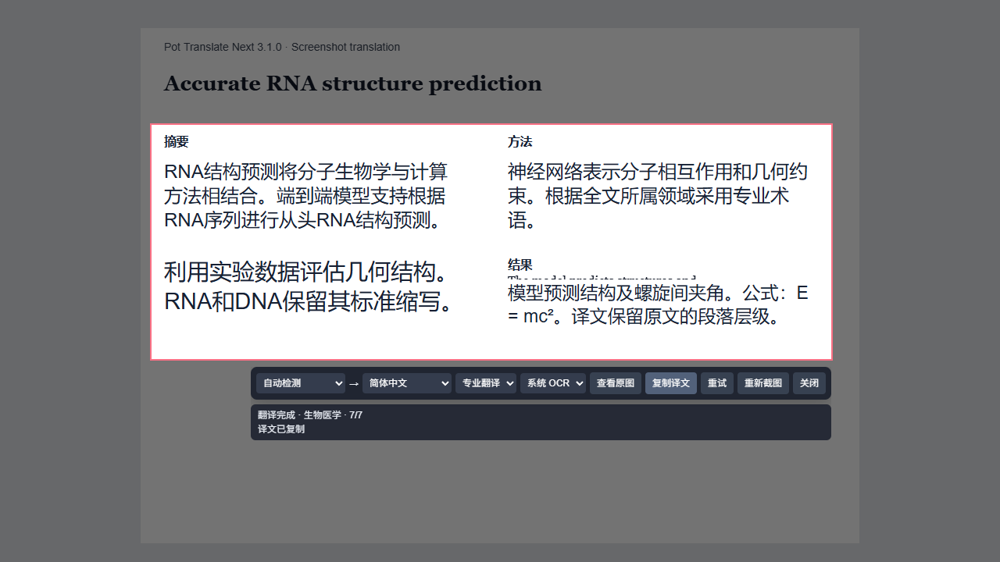

# Pot Translate Next

基于 [Pot Desktop](https://github.com/pot-app/pot-desktop) 二次开发的桌面翻译工具，支持同声传译、截图原位翻译、划词翻译、主页输入翻译和原文、译文逐句联动高亮。当前发布版本 **3.2.0**。

## 3.2.0 Windows MSI 发布

从 [GitHub Releases](https://github.com/ShengjieLi-CN/Pot-Translate-Next/releases/tag/v3.2.0) 下载 Windows x64 简体中文 MSI，安装包内包含当前全部功能：

- 主窗口左上角置顶按钮，支持高亮状态及取消置顶。
- 划词后显示“译”按钮，点击后仅显示译文，支持兼容取词、进度提示、失败重试和段落保持。
- 自定义 STT 与内置测试语音，可检查模型接口、转写结果、耗时及错误信息。
- 同声传译、截图原位翻译及输入翻译；译文保留原文段落，不逐句额外换行，允许自然折行。

[查看完整更新与安装说明](release/release-notes-3.2.0.md)。安装后需要自行配置翻译、OCR 或 STT 服务及凭据。校验文件与中文版 MSI 一同提供。


## 3.1.0 截图翻译

按演示视频的核心交互实现：拖动框选后，屏幕冻结并变暗，译文直接覆盖所选区域。支持原图对照、复制译文、重新截图、重试、原文和目标语言选择、翻译及 OCR 服务切换；Esc 或右键退出。小选区及靠近屏幕边缘时，工具栏自动移到屏幕内。

1. 在“服务设置”配置至少一个文字识别服务和文本翻译服务。
2. 点击左侧“截图翻译”→“开始截图翻译”，或使用已有的截图翻译快捷键、托盘菜单。
3. 框选完整段落，尽量留一点边距。松开鼠标后自动识别和翻译。
4. 点击“查看原图”对照；译文过长时会自动缩小字号，达到最小字号后可在对应段落内滚动阅读。



预览由真实前端和模拟 OCR、翻译响应生成，用于展示双栏排版及交互，未使用真实翻译 API 密钥。

- **文本恢复**：合并英文换行断词，如 `geome-\ntrical` → `geometrical`；也识别明确的 `geome-trical` 排版残留，保留 `end-to-end` 等正常复合词。公式、代码、列表和段落间空行保留。
- **边缘残字**：Windows 系统 OCR 和 Tesseract 提供位置框时，保守忽略触及截图边缘的残缺词；整行位置也用于避免误删 Tesseract 的异常单词框。仅返回纯文字的服务无法可靠判断边缘残字。
- **专业领域**：结合全文判断领域。OpenAI 兼容服务、Ollama、ChatGLM 和 Gemini 在截图任务中使用专用提示词，包含全文上下文、文本纠错、层级保持及“从头RNA结构预测”等术语规则，不改写用户保存的普通翻译提示词。截图中的指令视为文档内容。
- **格式**：Windows 系统 OCR、Tesseract 支持按文字位置覆盖，分组段落、标题并识别双栏，包括 OCR 将两栏合为一行的情况。其他 OCR 服务或插件仍可使用，纯文字结果采用可滚动的段落排版，不推测位置。复杂表格、旋转文字和三栏以上排版未作精确重排保证。
- **服务条件**：普通翻译服务继续使用原有文本接口；全文专业规则依赖支持自定义提示词的模型，实际准确性也依赖 OCR 和模型能力。Windows 系统 OCR 需要相应语言包；本机只有中文识别引擎，英语论文可选择 Tesseract 并将原文设为英语。Tesseract 首次使用需要联网获取语言数据。
- **请求与数据**：截图发给所选 OCR 服务，文字发给所选翻译服务。模型按段落请求，每次附带全文上下文，长截图可能增加费用和延迟。切换服务、语言、重试或重新截图后，旧请求的结果被忽略，后续段落停止请求；已发出的服务端请求可能仍会完成。
- **兼容入口**：原文字识别流程保留；`/ocr_translate?screenshot=false` 的现有图片和 macOS 系统截图进入专用图片翻译窗口。原位屏幕覆盖适用于 Windows / Linux；此次原生编译及安装包验证针对 Windows x64。

开发验证：`pnpm test`（24 项）、`pnpm build`、Windows Rust release 编译。`.scripts/verify-screenshot-ui.cjs` 使用 Playwright 和模拟服务验证框选、双栏、上下文提示词、断词恢复、原图对照、复制、服务切换、失败重试、重截图、小选区、退出、空服务、空 OCR、纯文字 OCR 和旧文字识别流程。先启动 `pnpm dev --port 5173`，并在环境中提供 Playwright；可通过 `PLAYWRIGHT_MODULE_PATH`、`CHROME_PATH` 和 `UI_URL` 指定模块及浏览器路径。

## 新功能

-   **主页输入翻译**：主窗口左侧新增“输入翻译”，默认打开。右侧上方输入原文，下方显示结果，中间保留原有语言选择和交换控件。
-   **自动识别语言**：调用原有语言检测服务，也可手动指定原语言和目标语言。支持英汉双向翻译及原有语言选项。
-   **原生样式一致**：复用 app 的侧边栏、卡片、按钮、字体设置及浅色、深色主题。
-   **逐句定位**：鼠标移到译文中的一句，原文中对应的句子和该句译文同步显示浅黄色背景；移出译文区域后清除高亮。
-   **键盘定位**：使用 Tab 聚焦译句，也能查看对应原句。原句超出输入区时会自动滚动到可见位置。
-   **直接编辑**：支持粘贴和修改原文；Enter 翻译，Shift+Enter 换行。中文输入法确认候选词时不会触发翻译。
-   **多服务兼容**：结果卡片内可切换已启用的翻译服务和插件，支持流式译文。
-   **草稿保留**：进入设置后再返回输入翻译，保留尚未提交的输入内容。
-   **保留原有弹窗**：划词翻译和输入翻译快捷键沿用独立翻译窗口；其中的“常规翻译”支持整段翻译。截图翻译使用 3.1.0 的原位覆盖界面。

[查看主窗口输入翻译预览](pot-desktop/asset/main-translation-preview.png)

_界面示例使用模拟的翻译服务响应，展示真实前端组件的逐句高亮效果。实际译文取决于所配置的服务。_

## 使用方法

1. 打开应用主窗口，点击左侧“输入翻译”。新建主窗口默认打开此页。
2. 输入或粘贴内容，原语言默认“自动检测”、目标语言默认“简体中文”。按 Enter 或点击“翻译”；当检测语言与目标语言相同时，沿用原设置翻译为第二语言（默认英语）。
3. 将鼠标放在译文中的句子上，查看原句和译句的浅黄色高亮。修改原文后，旧译文的对应高亮会暂停，重新翻译后恢复。
4. 通过语言栏和结果卡片选择语言、翻译服务。需要整段上下文翻译时，可在原有独立翻译窗口选择“常规翻译”。

请先在设置中启用并配置至少一个文本翻译服务。服务要求的 API 密钥仍通过原有设置界面填写。

## 实现与限制

主窗口输入翻译和弹窗的英汉互译模式先按句号、问号、感叹号和换行切分原文，再对每句分别请求翻译，并保存其原文位置。译文即使被服务拆成多个句子，也归属于同一个原句，避免按译文句子数量猜测对应关系。

-   每个服务按顺序请求各句；长文本的请求次数和延迟会增加，也可能增加付费服务的费用。需要完整段落上下文时请使用常规翻译。
-   主页调用“翻译设置”中配置的语言检测引擎；独立弹窗的英汉快捷模式根据是否包含汉字判断方向。中英混合文本可手动指定原语言。
-   单词词典仍可显示结构化释义。若多句请求返回词典数据，会提示切换文本翻译服务或常规模式。
-   切换模式、方向、服务或清空原文后，旧请求的后续更新会被忽略，后续句子不再发起请求；已经发出的网络请求可能仍在服务端执行。
-   分句优先使用 `Intl.Segmenter`；较旧的 WebView 使用标点分句回退，缩写等复杂边界可能需要手动换行。
-   逐句模式停用反向回译按钮；可以直接切换翻译方向重新翻译。

## 本地开发

前端使用 React 18、Vite 5、NextUI 和 Jotai，桌面层沿用 Tauri 1 / Rust。请安装 Node.js 和 pnpm；运行或打包桌面应用还需 Rust、Tauri 1 的系统依赖，Windows 包括 C++ 构建工具及 WebView2。

```sh
pnpm install
pnpm test
pnpm build
pnpm tauri dev
```

`pnpm dev` 只启动前端服务器。应用依赖 Tauri 的窗口、配置、HTTP 等 API，浏览器直接打开时需要提供相应模拟。

Windows x64 MSI 构建需要 Visual Studio 2022 的 C++ Build Tools / Windows SDK，以及 MSVC Rust 工具链和 rustfmt。安装命令：

```powershell
winget install --id Microsoft.VisualStudio.2022.BuildTools --exact --source winget --override "--wait --quiet --norestart --add Microsoft.VisualStudio.Workload.VCTools --includeRecommended"
rustup toolchain install stable-x86_64-pc-windows-msvc --profile minimal --component rustfmt
```

在项目根目录运行：

```powershell
.\.scripts\build-msi.ps1
```

脚本会自动选择 MSVC 工具链，不改变用户全局的 Rust 默认设置。Tauri 会下载 WiX 3 打包工具和 WebView2 安装引导程序；系统已安装 WebView2 时无需重复安装。

安装包输出到 `src-tauri/target/x86_64-pc-windows-msvc/release/bundle/msi/`，仅提供简体中文版。MSI 构建使用独立的 `Pot Translate Next` 名称和应用标识，清空上游自动更新地址。本地构建没有配置代码签名证书。

## 验证

-   `pnpm test`：48 项测试，包括分句与段落、划词、截图文本恢复、实时音频、说话人关联、字幕和请求生命周期测试。
-   `pnpm build`：前端生产构建。
-   浏览器交互验证：使用生产构建及模拟 Tauri / 翻译响应，检查主页默认入口、原有控件和主题、语言检测调用、服务切换、草稿保留、高亮、中文输入法、动态翻译、清空取消、错误恢复、无服务状态及 800px 窗口布局；同时回归原有弹窗。
-   `.scripts/build-msi.ps1`：Windows x64 release 原生编译和中文版 MSI 打包已通过。

当前开发环境已安装 Rust MSVC / rustfmt、Visual Studio 2022 C++ Build Tools 和 Windows SDK。真实翻译服务仍需在应用中配置后进行端到端验证。

## 上游与许可

本项目派生自 [pot-app/pot-desktop](https://github.com/pot-app/pot-desktop)，遵循 [GPL-3.0](LICENSE) 许可，保留上游源码和版权信息。原有功能和接口说明可参考 [上游英文说明](README_EN.md)。
