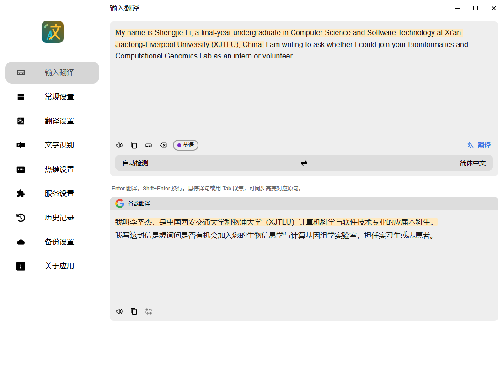
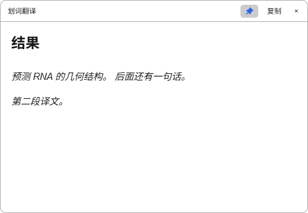

# Pot Translate Next (For Windows)

基于 [Pot Desktop](https://github.com/pot-app/pot-desktop) 二次开发的桌面翻译工具，专注中文使用体验。支持自动输入翻译、划词翻译、截图原位翻译和同声传译。

[下载 Windows x64 中文版 MSI](https://github.com/ShengjieLi-CN/Pot-Translate-Next/releases/latest) · [查看 3.2.2 更新说明](https://github.com/ShengjieLi-CN/Pot-Translate-Next/releases/tag/v3.2.2)

## 功能演示

演示图使用合成文本和模拟服务，不含个人信息；实际效果取决于所配置的服务。

### 截图原位翻译

快捷键或托盘启动，框选后直接在原位置显示译文。支持复杂图文、小字号英文、局部背景保留、原图对照和复制。

### 自动输入翻译

输入或粘贴后自动翻译，支持原文与译文逐句联动高亮。

### 划词翻译

选中文字后点击附近的圆形“译”按钮，浮窗仅显示译文，保留段落并合并 PDF 排版断行；支持置顶，切换应用后仍可查看。

## 其他功能

- 同声传译：系统声音或麦克风、自定义 STT、千问接口模板、模型测试、说话人标签和字幕导出。
- LibreTranslate 离线中英互译：首次从“服务设置”下载环境及模型，之后可离线使用。
- 云端备份：通过自建 OpenList 同步至夸克网盘，也支持 WebDAV 和本地备份。
- 四种背景材质：无、Mica、Acrylic、Apple Liquid Glass 风格模拟；支持窗口置顶。

## 开始使用

1. 从 [Releases](https://github.com/ShengjieLi-CN/Pot-Translate-Next/releases/latest) 下载简体中文 MSI；校验文件随安装包提供。
2. 在“服务设置”配置翻译、OCR 或离线引擎；同声传译在对应页面配置 STT。
3. 在“热键设置”配置截图及划词快捷键，划词开关与服务选项位于“翻译设置”。

云端服务需要自行提供凭据，发布文件不含个人配置。窗口材质取决于 Windows 支持情况；首次安装运行时或离线模型可能需要联网。

## 开发与许可

源码位于 `pot-desktop/`。本地构建使用 `pot-desktop/.scripts/build-local.ps1`，中文版 MSI 使用 `pot-desktop/.scripts/build-msi.ps1`。前端验证：在 `pot-desktop/` 下运行 `pnpm test`。

仅维护和发布简体中文版，翻译语言仍支持多语种。详细更新、安装说明及已知限制请查看各版本 [Release 页面](https://github.com/ShengjieLi-CN/Pot-Translate-Next/releases)。

遵循 [GPL-3.0](pot-desktop/LICENSE) 许可；第三方依赖和模型保留各自许可证。
